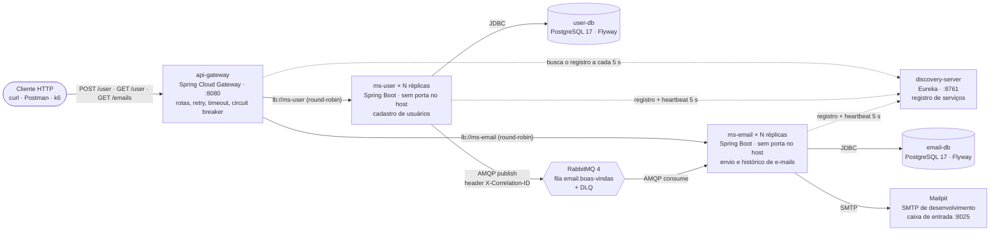
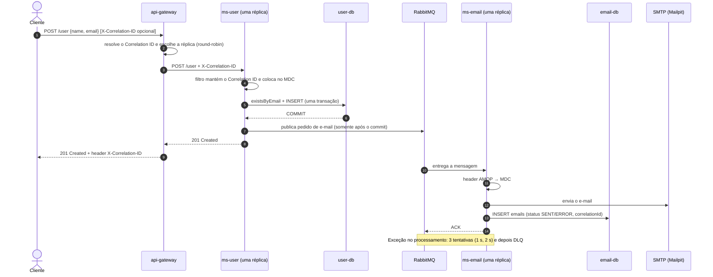

# Documento de Arquitetura — Cadastro de Usuários com Notificação por E-mail

| | |
|---|---|
| **Sistema** | `cadastro-notificacao` — microsserviços `ms-user` e `ms-email`, atrás de `api-gateway` e `discovery-server` |
| **Grupo** | _preencher com os integrantes_ |
| **Versão do documento** | 1.2 (ver [Histórico de revisões](#11-histórico-de-revisões)) |
| **Stack** | Java 21 · Spring Boot 4.1 · Spring Cloud 2025.1 (Gateway, Eureka) · PostgreSQL 17 + Flyway · RabbitMQ 4 · Docker Compose |

---

## 1. Contexto e problema

Uma aplicação precisa **cadastrar usuários** e, a cada cadastro, **enviar um e-mail de boas-vindas**.

O envio de e-mail depende de um servidor SMTP externo, que é lento (centenas de milissegundos a alguns segundos por mensagem), sujeito a instabilidade e a limites de envio do provedor. Se o cadastro esperasse o SMTP responder:

- a **latência** do cadastro passaria a ser a latência do provedor de e-mail;
- a **disponibilidade** do cadastro ficaria limitada à do provedor (SMTP fora do ar = ninguém consegue se cadastrar);
- um pico de cadastros viraria um pico de conexões SMTP, sem nenhum "amortecedor".

**Problema arquitetural:** como estruturar cadastro e notificação para que:

1. o cadastro responda rápido e continue disponível mesmo quando o envio de e-mail falha;
2. os pedidos de e-mail não se percam;
3. seja possível rastrear um cadastro específico até o e-mail correspondente;
4. cada parte possa evoluir, ser implantada e escalada de forma independente.

**Escopo:** dois microsserviços (`ms-user` e `ms-email`) com várias réplicas cada, o API Gateway e o registro de serviços na frente deles, a infraestrutura que usam e o ambiente local completo. **Fora de escopo:** autenticação de usuários finais, front-end e templates HTML de e-mail.

## 2. Requisitos

### 2.1 Funcionais

| ID | Requisito | Serviço |
|---|---|---|
| RF01 | Cadastrar usuário (nome e e-mail válidos). O e-mail é **único** — duplicado retorna `409 Conflict` | ms-user |
| RF02 | Listar usuários de forma **paginada** (máx. 100 por página) | ms-user |
| RF03 | Enviar e-mail de boas-vindas após cada cadastro | ms-email |
| RF04 | Registrar o resultado de cada envio (`SENT`/`ERROR`) e consultar o histórico geral ou por usuário | ms-email |

### 2.2 Atributos de qualidade (requisitos não funcionais)

| Atributo | Cenário | Como a arquitetura atende |
|---|---|---|
| Desempenho | Cadastro responde em p95 < 200 ms com 50 req/s | E-mail fora do caminho síncrono (ADR-0001) |
| Disponibilidade | SMTP fora do ar não impede cadastros | Fila desacopla os serviços (ADR-0001) |
| Confiabilidade | Pedido de e-mail não se perde se o ms-email estiver parado | Fila durável, retry, DLQ (ADR-0001) |
| Independência | Mudança no esquema de um serviço não quebra o outro | Banco por serviço (ADR-0002) |
| Observabilidade | Rastrear um cadastro até o e-mail em segundos | Correlation ID + logs JSON (ADR-0003) |
| Segurança | Nenhuma credencial no repositório; bancos isolados | Variáveis de ambiente, redes separadas (ADR-0004) |
| Implantabilidade | Ambiente completo sobe com um comando | `docker compose up --build` (ADR-0004) |
| Escalabilidade | Dobrar as réplicas de um serviço sem mudar o cliente; réplica nova recebe tráfego em segundos | Gateway + registro de serviços + réplicas sem estado (ADR-0005) |
| Disponibilidade | Uma réplica cai e as requisições seguem nas outras | Balanceamento, retry de `GET`, circuit breaker no gateway (ADR-0005) |
| Evolutividade | Mudança de esquema versionada e reproduzível em qualquer máquina | Migrações Flyway (ADR-0006) |

## 3. Visão da arquitetura

### 3.1 Diagrama de containers (C4 — nível 2)



### 3.2 Fluxo principal — cadastro com e-mail de boas-vindas



A fila não passa pelo gateway: todas as réplicas do `ms-email` consomem da mesma fila `email.boas-vindas`, e o RabbitMQ entrega cada mensagem a um único consumidor.

### 3.3 Responsabilidades

| Componente | Responsabilidade | Dados próprios | Não faz |
|---|---|---|---|
| **api-gateway** | Porta de entrada única: rotear `/user` e `/emails` para réplicas registradas, resolver o Correlation ID, aplicar retry, timeout e circuit breaker, responder `503`/`504` em Problem Details | — (só o cache do registro) | Não tem regra de negócio, não autentica (ainda) |
| **discovery-server** | Manter o registro de réplicas vivas (Eureka): cada réplica se registra ao subir, renova a cada 5 s e sai ao parar | registro em memória | Não roteia tráfego |
| **ms-user** | Validar e cadastrar usuários, garantir e-mail único, publicar o pedido de boas-vindas | tabela `users` (user-db) | Não fala com SMTP, não lê o banco de e-mails |
| **ms-email** | Consumir pedidos, enviar via SMTP, registrar o histórico, expor consulta | tabela `emails` (email-db) | Não conhece regras de cadastro |
| **RabbitMQ** | Armazenar pedidos de forma durável entre produtor e consumidor; DLQ para falhas | filas `email.boas-vindas` e `email.boas-vindas.dlq` | — |
| **Mailpit** | SMTP falso de desenvolvimento, com caixa de entrada web | — | Não entrega e-mail de verdade |

### 3.4 Contrato da mensagem

Fila `email.boas-vindas` (exchange padrão, routing key = nome da fila), corpo JSON:

```json
{
  "userId": "4b0e2c1d-7c1e-4c55-9a4e-3f1b2a9d8e10",
  "emailTo": "maria.silva@example.com",
  "subject": "Cadastro realizado com sucesso!",
  "text": "Maria Silva, seja bem-vindo(a)! ..."
}
```

Headers AMQP: `X-Correlation-ID` (e a propriedade `correlation_id`) com o mesmo ID da requisição HTTP original; `__TypeId__` (gerado pelo conversor Jackson).

### 3.5 API

Todo o tráfego entra por **`http://localhost:8080`** (`api-gateway`). Os caminhos são os mesmos de antes do gateway; só muda a porta.

| Método e caminho em `:8080` | Roteado para | Resposta |
|---|---|---|
| `POST /user` | ms-user | `201` usuário criado · `400` validação · `409` e-mail já cadastrado |
| `GET /user?page=0&size=20` | ms-user | `200` lista paginada (ordenada por e-mail) |
| `GET /emails?page=0&size=20` | ms-email | `200` histórico, mais recentes primeiro |
| `GET /emails/user/{userId}` | ms-email | `200` histórico de um usuário |
| `GET /health`, `/health/liveness`, `/health/readiness` | o próprio gateway | Estado do gateway; `/health` lista as réplicas registradas (`discoveryComposite`) |
| `GET /metrics/{nome}` | o próprio gateway | Métricas Micrometer (ex.: `spring.cloud.gateway.requests` por rota) |
| qualquer outro caminho | — | `404` sem chamar nenhum serviço |

Respostas dos serviços (inclusive `4xx` e `500`) passam pelo gateway sem alteração. O gateway só produz erro próprio quando não consegue uma resposta:

| Situação | Resposta do gateway |
|---|---|
| Nenhuma réplica registrada, réplica recusando conexão ou circuit breaker aberto | `503` · `"title": "Serviço indisponível"` |
| Réplica não respondeu em 5 s | `504` · `"title": "Tempo de resposta esgotado"` |

Erros seguem o padrão **Problem Details (RFC 9457)** (`type`, `title`, `status`, `detail`, `instance`, `correlationId`). Toda resposta (sucesso ou erro) traz o header `X-Correlation-ID`; no `409`, `503` e `504` o `correlationId` também vai no corpo.

O painel e a API do Eureka ficam em `http://localhost:8761` (só em `127.0.0.1`), por exemplo `GET /eureka/apps/MS-USER`.

## 4. Decisões arquiteturais

As decisões estão registradas como ADRs em [`docs/adr/`](adr/README.md):

| ADR | Decisão | Atributos de qualidade afetados |
|---|---|---|
| [ADR-0001](adr/0001-comunicacao-assincrona-com-rabbitmq.md) | Comunicação assíncrona via RabbitMQ, publicação após o commit, retry e DLQ | Disponibilidade, desempenho, confiabilidade |
| [ADR-0002](adr/0002-banco-de-dados-por-servico.md) | Um PostgreSQL por serviço, isolado por rede | Independência, isolamento de falhas, segurança |
| [ADR-0003](adr/0003-observabilidade-correlation-id-e-logs-estruturados.md) | Logs JSON (ECS) + Correlation ID propagado por HTTP e AMQP + health checks do Actuator | Observabilidade, operabilidade |
| [ADR-0004](adr/0004-ambiente-containerizado-e-segredos-por-variaveis-de-ambiente.md) | Ambiente 100% local em Docker Compose e segredos fora do código | Implantabilidade, segurança, reprodutibilidade |
| [ADR-0005](adr/0005-api-gateway-e-service-discovery.md) | API Gateway (Spring Cloud Gateway) + registro de serviços (Eureka) + réplicas dos serviços | Escalabilidade, disponibilidade, operabilidade |
| [ADR-0006](adr/0006-migracoes-de-esquema-com-flyway.md) | Esquema dos bancos versionado com Flyway, `ddl-auto: validate` | Evolutividade, reprodutibilidade, segurança com várias réplicas |

## 5. SLOs (Service Level Objectives)

### 5.1 Objetivos

| ID | SLI (o que é medido) | Objetivo (SLO) | Janela | Fonte da medição |
|---|---|---|---|---|
| **SLO-1** | Disponibilidade do cadastro: % de `POST /user` que **não** terminam em 5xx ou timeout | **≥ 99,5%** | 30 dias corridos | k6 (`http_req_failed`); em produção, métrica `http.server.requests` por status |
| **SLO-2** | Latência do cadastro `POST /user`, medida no cliente | **p95 < 200 ms** e **p99 < 500 ms** com 50 req/s | 30 dias | k6; conferência com `/metrics/http.server.requests.percentile` |
| **SLO-3** | Latência da listagem `GET /user?size=20`, medida no cliente | **p95 < 150 ms** e **p99 < 300 ms** com 50 req/s | 30 dias | k6 |
| **SLO-4** | Entrega assíncrona: tempo entre o `201` do cadastro e o e-mail registrado no ms-email | **99% em até 10 s**; p95 < 2 s | 30 dias | k6 (cenário ponta a ponta); profundidade da fila no RabbitMQ |

### 5.2 Justificativa dos valores

- **Por que percentis e não média:** a média esconde a cauda. Se 1 em cada 100 cadastros leva 3 s, a média quase não muda, mas o p99 mostra o problema — e é exatamente esse usuário que reclama.
- **200 ms no p95 do cadastro:** abaixo de ~100–200 ms a resposta é percebida como imediata; como o e-mail saiu do caminho síncrono, o cadastro faz apenas uma consulta, um `INSERT` e uma publicação local no broker, então o valor é folgado e deixa margem para a rede em produção.
- **10 s para o e-mail:** o usuário espera receber a confirmação "logo", não instantaneamente; 10 s cobre o retry (1 s + 2 s) e pequenos acúmulos na fila.
- **99,5% de disponibilidade:** os serviços agora têm réplicas (ADR-0005), mas Postgres, RabbitMQ, `api-gateway` e `discovery-server` continuam com uma instância cada (seção 9, item 10). A disponibilidade do cadastro é limitada pelo componente mais frágil do caminho, então o alvo continua 99,5%. Prometer 99,9% exigiria redundância também nesses quatro.
- **50 req/s de carga nominal:** hipótese de pico (ex.: campanha de divulgação). Está registrada aqui para ser revista com dados reais de uso.

### 5.3 Orçamento de erro (error budget)

SLO-1 de 99,5% em 30 dias = **0,5% de falhas permitidas**: até 5 cadastros com falha a cada 1.000, ou ~3 h 36 min de indisponibilidade total no mês. Política proposta: enquanto houver orçamento, a equipe entrega funcionalidades normalmente; se o orçamento acabar, novas funcionalidades param e a prioridade passa a ser confiabilidade até o indicador voltar ao alvo.

### 5.4 Resultado da medição

Metodologia, números (p50, p95, p99, throughput) e a conclusão sobre a aderência a cada SLO estão em [`docs/performance/resultado-medicao.md`](performance/resultado-medicao.md).

## 6. Estratégia de observabilidade

Detalhada no [ADR-0003](adr/0003-observabilidade-correlation-id-e-logs-estruturados.md). Resumo:

### 6.1 Logs estruturados

- Formato **JSON (Elastic Common Schema)**, nativo do Spring Boot (`logging.structured.format.console: ecs`) — sem biblioteca extra.
- Todo log carrega `service.name` (`ms-user`/`ms-email`), nível, logger, thread e o **`correlationId`** (vindo do MDC).
- Os dois serviços e o `api-gateway` registram um log de acesso por requisição HTTP (método, caminho, status, duração). `/health`, `/metrics` e `/info` ficam de fora para não poluir.
- Com réplicas, `docker compose logs ms-user` junta todas; o prefixo da linha (`ms-user-1`, `ms-user-2`...) diz qual réplica atendeu.
- Dados pessoais são **mascarados** (`m***@gmail.com`) — ver seção 7.

Exemplo no formato ECS do Spring Boot 4 (no terminal é uma única linha por evento; quebrada aqui para leitura — o grupo pode trocar por uma linha real de `docker compose logs ms-user`):

```json
{"@timestamp":"2026-11-03T13:02:11.482Z",
 "log":{"level":"INFO","logger":"com.ms.user.services.UserService"},
 "process":{"pid":1,"thread":{"name":"http-nio-8081-exec-3"}},
 "service":{"name":"ms-user"},
 "message":"Usuário cadastrado (userId=4b0e2c1d-..., email=m***@example.com)",
 "correlationId":"apresentacao-0001",
 "ecs":{"version":"8.11"}}
```

### 6.2 Correlation ID — caminho completo

1. **Borda:** o `CorrelationIdWebFilter` do `api-gateway` aceita o header `X-Correlation-ID` do cliente se ele for "seguro" (`^[A-Za-z0-9-]{8,64}$`); caso contrário gera um UUID. Essa validação impede *log injection*. O ID segue no header da requisição repassada à réplica e volta na resposta.
1. **Entrada no serviço:** o `CorrelationIdFilter` (primeiro filtro da cadeia) aplica a mesma regra; como o gateway já mandou um ID válido, ele é mantido.
2. **MDC:** o ID vai para o MDC (`correlationId`) e aparece em todo log da requisição.
3. **Resposta:** o ID volta no header `X-Correlation-ID` de toda resposta (e no corpo do erro `409`) — o cliente pode informá-lo ao suporte.
4. **AMQP:** o `UserProducer` copia o ID para o header `X-Correlation-ID` e a propriedade `correlation_id` da mensagem.
5. **Consumidor:** o `EmailConsumer` lê o header e o coloca no MDC enquanto processa a mensagem.
6. **Persistência:** o ID é gravado na coluna `correlation_id` da tabela `emails` e devolvido por `GET /emails`.

Investigação típica ("não recebi meu e-mail"): pegar o `correlationId` da resposta ou de `GET /emails/user/{id}` e rodar
`docker compose logs api-gateway ms-user ms-email | grep <correlationId>` — aparece a história completa no gateway e nos dois serviços, com a réplica que atendeu.

### 6.3 Health checks

| Endpoint | Verifica | Uso |
|---|---|---|
| `/health` | Visão geral com detalhes de cada componente (banco, RabbitMQ, disco) | Diagnóstico humano |
| `/health/liveness` | Só se a aplicação está viva (não consulta dependências) | Reiniciar o container se travar |
| `/health/readiness` | `readinessState` + banco (`db`) + RabbitMQ (`rabbit`) | `healthcheck` do Docker Compose; tráfego só depois de pronto |

O SMTP **não** entra no readiness do ms-email: com o SMTP fora do ar o serviço continua útil (consome e registra `ERROR`), então não deve ser marcado como indisponível.

No `api-gateway`, o readiness considera só o próprio estado (`readinessState`): com o `discovery-server` fora, o gateway continua roteando com a última lista de réplicas que conhece, então não deve sair do ar por isso. O `/health` do gateway mostra as réplicas registradas em `discoveryComposite`. O `discovery-server` usa `/actuator/health`.

### 6.4 Métricas

- **Micrometer/Actuator** em `/metrics`: `http.server.requests` com percentis p50/p95/p99 calculados no próprio serviço (conferência independente do k6), uso de JVM, pool de conexões (HikariCP), métricas do RabbitMQ. Os serviços não têm porta no host; para ler as métricas de uma réplica: `docker compose exec --index 1 ms-user curl -s localhost:8081/metrics/http.server.requests`.
- **Na borda:** o gateway publica `spring.cloud.gateway.requests` por rota (`routeId`), com p50/p95/p99, em `http://localhost:8080/metrics`.
- **RabbitMQ Management** (`http://localhost:15672`): profundidade da fila (backlog), taxa de publicação/consumo, número de consumidores e mensagens na DLQ — indicadores diretos do SLO-4.

### 6.5 Alertas propostos (para um ambiente de produção)

| Alerta | Condição | SLO protegido |
|---|---|---|
| Taxa de erro do cadastro | 5xx > 0,5% por 5 min | SLO-1 |
| Latência do cadastro | p95 > 200 ms por 10 min | SLO-2 |
| Fila acumulando | `email.boas-vindas` > 1.000 mensagens ou sem consumidor por 2 min | SLO-4 |
| Mensagens na DLQ | DLQ > 0 | SLO-4 |
| Serviço não pronto | `/health/readiness` ≠ UP por 1 min | SLO-1 |

### 6.6 O que fica para depois

Rastreamento distribuído com **OpenTelemetry** (spans com tempo de cada etapa, padrão W3C `traceparent`) e centralização de logs/métricas (ex.: Loki/Elastic + Prometheus/Grafana). O Correlation ID atual cobre o essencial — ligar os logs dos dois serviços — sem infraestrutura extra.

## 7. Estratégia de segurança

| Tema | Medida adotada | Onde |
|---|---|---|
| **Segredos** | Nenhuma senha real no código; tudo vem de variáveis de ambiente. `.env` está no `.gitignore`; `.env.example` documenta as variáveis. Os padrões só servem para o ambiente local | `application.yaml`, `docker-compose.yml`, ADR-0004 |
| **Credenciais expostas anteriormente** | As versões antigas dos repositórios tinham usuário/senha do CloudAMQP e do SMTP no `application.yaml`. Essas credenciais devem ser **revogadas/rotacionadas** no provedor, pois continuam no histórico do Git | Ação do grupo — ver README |
| **Isolamento de rede** | Cada banco fica numa rede Docker própria, acessível apenas pelo seu serviço (`user-net`, `email-net`); broker em `broker-net`. Os serviços não publicam porta no host: só o `api-gateway` (`:8080`) recebe tráfego de fora. Portas de infraestrutura e o painel do Eureka publicados só em `127.0.0.1` | `docker-compose.yml`, ADR-0005 |
| **Menor privilégio** | Usuário de banco distinto por serviço; containers rodam como usuário **não-root**; imagem final só com JRE (sem Maven/JDK) | `Dockerfile`, ADR-0002 |
| **Validação de entrada** | Bean Validation (`@NotBlank`, `@Email`); e-mail normalizado e com `UNIQUE` no banco; tamanho de página limitado a 100 (evita respostas gigantes); Correlation ID externo validado por regex (evita *log injection*) | `UserRecordDto`, `UserController`, `CorrelationId` |
| **Dados pessoais (LGPD)** | Coleta mínima (nome e e-mail); e-mails **mascarados** nos logs; mensagens de erro do banco/SMTP que contêm o endereço não são logadas em nível INFO/WARN | `LogMasking`, `GlobalExceptionHandler`, `EmailService` |
| **Exposição de detalhes** | `/health` com detalhes (`always`) só em desenvolvimento; em produção `HEALTH_SHOW_DETAILS=when-authorized` | variável `HEALTH_SHOW_DETAILS` |
| **Transporte** | Broker em nuvem via **AMQPS** (TLS) e SMTP real com **STARTTLS**, ambos configuráveis por variável. No ambiente local o tráfego fica dentro das redes Docker | `RABBITMQ_ADDRESSES`, `MAIL_SMTP_STARTTLS` |

**Lacunas conhecidas (riscos aceitos para o escopo da disciplina):**

- As APIs **não têm autenticação/autorização**. O API Gateway já existe (ADR-0005); próximo passo: validar OAuth2/JWT nele e com Spring Security (Resource Server) nos serviços.
- `/metrics` e `GET /emails` expõem informação operacional e dados pessoais sem controle de acesso.
- O `discovery-server` não autentica quem se registra: qualquer container na rede `edge` poderia registrar uma instância falsa. Aceito porque a rede é local e o painel só escuta em `127.0.0.1`.
- Sem *rate limiting* e sem TLS na borda HTTP (os dois cabem no gateway).

## 8. Ambiente containerizado

Um único [`docker-compose.yml`](../docker-compose.yml) sobe tudo com `docker compose up --build -d` (ADR-0004).

| Serviço | Imagem | Porta no host | Redes | Espera por |
|---|---|---|---|---|
| `rabbitmq` | `rabbitmq:4-management` | 127.0.0.1:5672, 127.0.0.1:15672 | broker-net | — |
| `user-db` | `postgres:17-alpine` | 127.0.0.1:5433 | user-net | — |
| `email-db` | `postgres:17-alpine` | 127.0.0.1:5434 | email-net | — |
| `mailpit` | `axllent/mailpit` | 127.0.0.1:8025 (UI), 127.0.0.1:1025 | email-net | — |
| `discovery-server` | build `./discovery-server` | 127.0.0.1:8761 (`DISCOVERY_UI_PORT`) | edge | — |
| `api-gateway` | build `./api-gateway` | 8080 (`GATEWAY_PORT`) | edge | discovery-server iniciado |
| `ms-user` (réplicas: `MS_USER_REPLICAS`, padrão 2) | build `./ms-user` | — | edge, broker-net, user-net | user-db e rabbitmq saudáveis, discovery-server iniciado |
| `ms-email` (réplicas: `MS_EMAIL_REPLICAS`, padrão 2) | build `./ms-email` | — | edge, broker-net, email-net | email-db, rabbitmq e mailpit saudáveis, discovery-server iniciado |
| `k6` (perfil `loadtest`) | `grafana/k6` | — | edge | api-gateway, ms-user e ms-email saudáveis |

- **Ordem de subida** garantida por `healthcheck` + `depends_on: condition: service_healthy`. O `ms-user` **não** depende do `ms-email`, coerente com a comunicação assíncrona. Os serviços esperam o `discovery-server` só iniciar (não ficar saudável): o cliente do Eureka tenta de novo sozinho.
- **Réplicas:** `ms-user` e `ms-email` não publicam porta nem têm `container_name`, então `docker compose up -d --scale ms-user=4` funciona sem conflito. Cada réplica se registra no Eureka com o IP da rede `edge` e um `instanceId` único (`ms-user:<hostname do container>`).
- **Build multi-stage:** Maven + JDK 21 só no estágio de build; a imagem final tem apenas o JRE e o `.jar`.
- **Limites:** 1 CPU e 768 MB por serviço Java (cada réplica) e 512 MB para `api-gateway` e `discovery-server` — torna as medições comparáveis entre as máquinas do grupo. No padrão (2 + 2 réplicas) o ambiente pede cerca de 5 GB; o Docker precisa de pelo menos 6 GB de memória.
- **Conexões ao banco:** cada réplica abre no máximo `DB_POOL_MAX_SIZE` (padrão 10) conexões; com 5 réplicas são 50, abaixo do limite de 100 do Postgres.

## 9. Riscos, trade-offs e anti-patterns reconhecidos

Itens conhecidos e **aceitos conscientemente**, com mitigação atual e caminho de evolução:

| # | Item | Por que existe | Mitigação atual | Evolução |
|---|---|---|---|---|
| 1 | **Dual write** (gravar no banco e publicar no broker não é atômico) | Simplicidade | Publicação **após o commit**: nunca sai e-mail de usuário que não foi salvo. Se o broker cair nesse instante, o usuário fica salvo sem e-mail — erro registrado em log com `correlationId` | Padrão **Transactional Outbox** |
| 2 | **Entrega "pelo menos uma vez"** | Garantia padrão do RabbitMQ com ACK | Retry limitado a 3 tentativas + DLQ | Chave de idempotência (ex.: `correlationId`) antes de enviar |
| 3 | **Mensagem de comando** (o ms-user define assunto e texto do e-mail) | Herdado da versão inicial; simples | Contrato pequeno e documentado | Publicar evento de domínio `UsuarioCriado` e o ms-email decidir o conteúdo |
| 4 | **Contrato de mensagem sem versionamento** (`EmailDto` e `EmailRecordDto` duplicados) | Serviços sem biblioteca compartilhada | Contrato documentado na seção 3.4 | Testes de contrato ou schema versionado |
| 5 | **Fila declarada nos dois serviços** | Evita perder mensagens se o ms-user subir antes do ms-email | Declaração idempotente; argumentos idênticos e comentados no código | Topologia declarada por infraestrutura (definitions do RabbitMQ) |
| 6 | **Código de observabilidade duplicado** (`CorrelationId`, filtro) | Só 2 serviços; biblioteca compartilhada criaria acoplamento de versão | Classes pequenas e idênticas | Biblioteca interna ou OpenTelemetry quando houver mais serviços |
| 7 | **Migrações só para frente** (Flyway Community não desfaz migrações) | O esquema passou a ser versionado (ADR-0006); desfazer automaticamente é recurso pago | Migrações pequenas e revisadas; `ddl-auto: validate` recusa subir com esquema divergente | Migração corretiva `V<n+1>`; backup antes de migrar em produção |
| 8 | Entidade JPA exposta diretamente na API | Herdado da versão inicial | Entidades sem relacionamentos (sem risco de lazy loading) | DTOs de resposta |
| 9 | APIs sem autenticação | Fora do escopo | Documentado na seção 7 | OAuth2/JWT validado no gateway |
| 10 | **Pontos únicos de falha:** Postgres, RabbitMQ, `api-gateway` e `discovery-server` (1 instância cada) | Ambiente de desenvolvimento | Serviços com réplicas; com o `discovery-server` fora, o gateway segue roteando com a última lista conhecida; SLO de 99,5% coerente com o que sobra | Réplicas do gateway atrás de um balanceador, Eureka em par, cluster RabbitMQ (quorum queues), Postgres gerenciado |
| 11 | **Retry só para `GET`** no gateway | Repetir `POST /user` poderia cadastrar duas vezes se a primeira tentativa chegou a gravar | `POST` que falha devolve `503`/`504` e o cliente decide; o e-mail único barra a duplicata com `409` | Chave de idempotência no `POST` |
| 12 | **Réplica morta sem aviso fica no registro por até ~30 s** | Eureka descobre a queda pela falta de heartbeat (intervalos de desenvolvimento, ADR-0005) | Retry de `GET` em outra réplica; circuit breaker; parada normal (SIGTERM) sai do registro em segundos | Health check ativo no balanceador, ou orquestrador (Kubernetes) com endpoints atualizados pelo próprio cluster |

## 10. Evoluções futuras

1. Transactional Outbox no ms-user (resolve o item 1).
2. Idempotência no ms-email (item 2).
3. Evento de domínio + exchange *topic* (itens 3 e 4) — permite novos consumidores (ex.: analytics) sem alterar o ms-user.
4. OpenTelemetry + Prometheus/Grafana + alertas da seção 6.5.
5. DTOs de resposta; autenticação e *rate limiting* no `api-gateway` (itens 8 e 9).
6. Redundância de gateway, registro, broker e bancos (item 10) — só então faz sentido rever o SLO-1 para 99,9%.

## 11. Histórico de revisões

| Versão | Data | Alteração | Origem |
|---|---|---|---|
| 1.0 | _preencher_ | Versão inicial consolidada | Grupo |
| 1.1 | _preencher_ | _Ajustes a partir do Peer Review — ver [`docs/peer-review/feedback-recebido.md`](peer-review/feedback-recebido.md)_ | Peer Review |
| 1.2 | 2026-11-06 | API Gateway, registro de serviços e réplicas (ADR-0005); migrações Flyway (ADR-0006); seções 2.2, 3, 4, 5.2, 6, 7, 8, 9 e 10 atualizadas | Escalabilidade |
